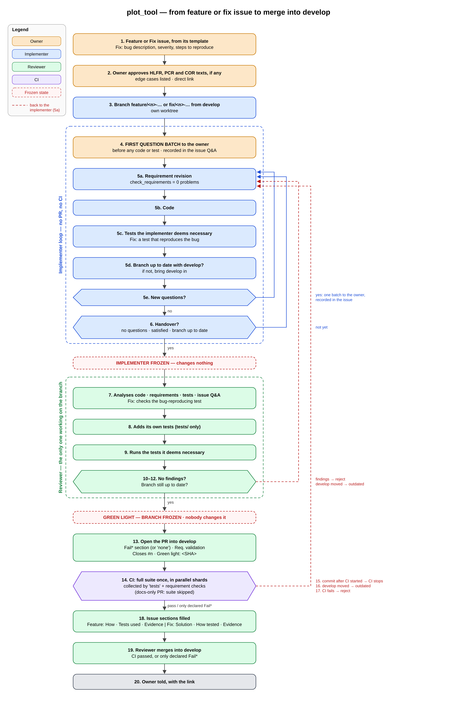

# From a feature or fix issue to the merge into develop

This document shows the process that every feature and every fix follows, from its GitHub issue to its merge into `develop` (PCR-00120), and then the release steps. Each step names the requirements of [process_of_collaboration.md](../requirements/process_of_collaboration.md) (PCR) that state it. The owner approved this flow on 2026-11-05.

The image is drawn from [feature_fix_flow.svg](feature_fix_flow.svg), which [make_feature_fix_flow.py](make_feature_fix_flow.py) writes. To regenerate them after a step changes (PCR-00114):

1. edit the tables at the top of `make_feature_fix_flow.py` and run `python docs/process/make_feature_fix_flow.py`, which writes `feature_fix_flow.svg`;
2. render `feature_fix_flow.png` from the SVG at twice its size, for example with `rsvg-convert -z 2 feature_fix_flow.svg -o feature_fix_flow.png`, or with a headless Chromium screenshot of the SVG at a device scale factor of 2.

A fix follows the same steps as a feature. It differs only where a step says "Fix".

## The steps

| Step | What happens | PCR |
|---|---|---|
| 1 | A Feature or Fix issue is created from its template. Fix: the issue holds the bug description, the severity and the steps to reproduce. | PCR-00004, PCR-00046, PCR-00012, PCR-00008, PCR-00009; Fix: PCR-00006, PCR-00007 |
| 2 | The owner approves the HLFR, PCR and COR texts, if the change creates or changes any, explicitly in the conversation with the coordinator before they are written, with the neighbouring cases listed and a direct link. Fix: only when such a requirement changes. | PCR-00029, PCR-00123, PCR-00124, PCR-00074, PCR-00077 |
| 3 | The implementer creates the branch `feature/<n>-…` or `fix/<n>-…` from the latest `develop`, in its own worktree. | PCR-00002, PCR-00003, PCR-00005, PCR-00039, PCR-00113, PCR-00026 |
| 4 | **First question batch:** before any code or test, the implementer sends the owner every question it has, in one batch, and records it, with the answers and the date, in the issue's "Questions and answers" section. | PCR-00099, PCR-00074, PCR-00103 |
| 5 | **The implementer's loop** (no pull request, no CI): | PCR-00100 |
| 5a | Requirement revision: LLFRs are written or changed, and `tests/check_requirements.py` shows 0 problems. | PCR-00030, PCR-00031, PCR-00115, PCR-00037 |
| 5b | Code. | PCR-00100, COR rules |
| 5c | The tests the implementer deems necessary are written and run before each push. Fix: a test that reproduces the bug, which fails before the fix and passes after it. | PCR-00024, PCR-00082; Fix: PCR-00116 |
| 5d | The branch is up to date with `develop`; if it isn't, the implementer brings `develop` in. The branch leaves `tests/test_matrix.md` as `develop` has it. | PCR-00101, PCR-00060, PCR-00081 |
| 5e | New questions go to the owner in one batch, recorded in the issue, and the loop starts again at 5a. | PCR-00100, PCR-00076, PCR-00103 |
| 6 | **Handover** to the reviewer only with no open question, a satisfied implementer and an up-to-date branch. From then on the implementer changes nothing on the branch. | PCR-00102, PCR-00075, PCR-00098 |
| 7 | The reviewer analyses the code, the requirements (with the judgement pass of the `requirement-validation` skill when requirements are new or changed), the tests and the issue's Q&A. Fix: it checks the bug-reproducing test. | PCR-00088, PCR-00089, PCR-00104, PCR-00016; Fix: PCR-00117 |
| 8 | The reviewer adds its own tests, changing only files under `tests/`. | PCR-00090, PCR-00091, PCR-00098 |
| 9 | The reviewer runs the tests it deems necessary. | PCR-00092 |
| 10 | Findings: the reviewer rejects the work, which goes back to 5a; after the fixes, it checks only the changes. | PCR-00093, PCR-00094 |
| 11 | `develop` moved during the review: the branch is outdated, and the work goes back to the implementer. | PCR-00109 |
| 12 | **Green light** only with no findings left and an up-to-date branch. From then on nobody changes the branch, the reviewer included. | PCR-00108, PCR-00105, PCR-00111 |
| 13 | The reviewer opens the pull request into `develop`. Its description starts with the Fail* section (or `- none`), has the requirement validation when requirements are added or changed, with the owner's approval of each HLFR, PCR or COR text, the line `Closes #<n>` and the line `Green light: <SHA>` (the last such line counts). | PCR-00095, PCR-00060, PCR-00070, PCR-00052, PCR-00053, PCR-00126, PCR-00118, PCR-00111, PCR-00122 |
| 14 | CI runs the whole suite once, split across parallel shard jobs that the `tests` check collects, and the requirement checks. A pull request that changes no code and no functional requirement skips the suite. A push to `develop` or `main` runs only the requirement checks; the macOS build runs only on pull requests. | PCR-00057, PCR-00127, PCR-00128, PCR-00078, PCR-00079, PCR-00080, PCR-00083, PCR-00121, PCR-00059, PCR-00038 |
| 15 | A commit after the green light, also after CI has started: CI stops, the `green-light` check fails, and the work goes back to the implementer. | PCR-00106, PCR-00107, PCR-00112 |
| 16 | `develop` moved during CI or before the merge: the branch is outdated, and the work goes back to the implementer. | PCR-00110 |
| 17 | CI fails: the work goes back to the implementer, and the reviewer checks only the fix. | PCR-00097, PCR-00062 |
| 18 | The issue's remaining sections are filled in. Feature: How the implementation was done, Tests used, Evidence. Fix: Solution, How the solution was tested, Evidence. | PCR-00014, PCR-00008; Fix: PCR-00006 |
| 19 | The reviewer merges into `develop` when CI passed, or showed only the Fail* entries declared in the Fail* section, with no further review. | PCR-00096, PCR-00016, PCR-00062, PCR-00064, PCR-00072 |
| 20 | The owner is told, with the link of the pull request. | PCR-00119, PCR-00077 |

## The release steps

| Step | What happens | PCR |
|---|---|---|
| R1 | The requirement validation of every requirement created or changed since the last release, and its independent review, before the release pull request is opened. | PCR-00050 |
| R2 | The release pull request from `develop` into `main`: it runs every test and shows zero Fail* of any kind, the list of issues and the evidence, and makes the screenshots. | PCR-00051, PCR-00058, PCR-00069, PCR-00017, PCR-00018, PCR-00129 |
| R3 | The owner approves and merges it. | PCR-00015 |
| R4 | An agent opens the matrix pull requests into `main` and into `develop`, which put the release run's matrix in `tests/test_matrix.md`, or an issue when the release run failed. The one into `main` holds the section `## Requirement validation (PCR-00050)` with "Not applicable: this PR changes only tests/test_matrix.md." The owner approves it as code owner and merges it, and an agent merges the one into `develop`. | PCR-00061, PCR-00085, PCR-00086, PCR-00083, PCR-00125, PCR-00084, PCR-00087 |
